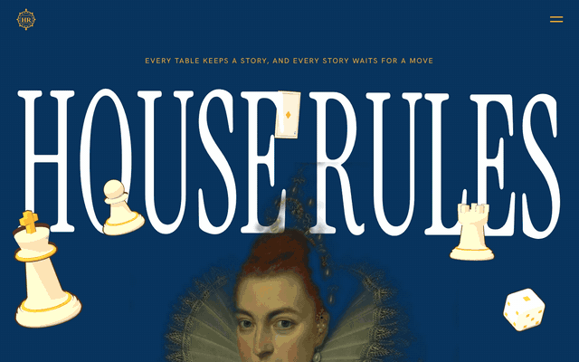

# House Rules — Board Game Shelf & Play Log

Situs statis HTML/CSS/JS native, tanpa build step dan tanpa server. Buka `index.html` langsung di browser (Chrome/Edge/Firefox); semua aset lokal, jadi offline pun jalan.

## Halaman
| File | Isi |
|---|---|
| `index.html` | Beranda: hero, rak koleksi pilihan, ringkasan play log |
| `collection.html` | Seluruh koleksi game (filter genre/jumlah pemain) |
| `plays.html` | Play log: daftar malam main dengan filter, sort, dan paginasi |
| `about.html` | "The Art of Play" — profil dadu, langkah studio |

## Struktur
```
index.html  collection.html  plays.html  about.html
assets/
  css/style.css       ← semua gaya (token di :root)
  js/data.js          ← SEMUA data & copy: brand, game, pemain, 80 malam main
  js/core.js          ← smooth scroll, loader, transisi halaman, menu, navbar, reveal, modal, footer
  js/pieces.js        ← bidak/dadu/kartu/koin/buku 3D (three.js)
  js/home.js | collection.js | plays.js | about.js   ← skrip per halaman
  js/vendor/          ← three.js, Lenis (lokal)
  fonts/              ← Gambarino, Hanken Grotesk, Instrument Serif
  img/                ← hero, foto game g01–g12, meja, logo & ornamen SVG
```

Urutan script di tiap halaman: `lenis` → `data.js` → (`three` → `pieces.js`, hanya beranda & about) → skrip halaman → `core.js`.

## Mengedit
- **Brand, email, sosial, game, pemain, malam main** → `assets/js/data.js`. Malam main dibuat dengan generator ber-seed, jadi log selalu sama di setiap load.
- **Teks statis** (judul, paragraf, footer, menu, modal) → edit langsung di file `.html`. Karena nav/footer diulang di tiap halaman, ubah di keempat file agar konsisten.
- **Gambar game** → ganti `assets/img/g01.jpg … g12.jpg` (rasio bebas, ditampilkan persegi).
- **Warna, spasi, tipografi** → token CSS di `:root` pada `assets/css/style.css`.
- **Deep link play log**: `plays.html?page=2&player=Mara&game=tilefolk&sort=oldest&night=34`.

## Placeholder yang perlu diganti
- Brand "House Rules", monogram HR, studio "KITE.STUDIO", email `hello@kite.studio`, link sosial (`#`).
- Nama game, penerbit, pemain, dan data malam main bersifat fiktif.

## Aset & lisensi
- Foto: Unsplash (lisensi Unsplash), disimpan lokal.
- Font: Hanken Grotesk & Instrument Serif (Google Fonts, OFL); Gambarino (Fontshare, ITF Free Font License).
- Library: three.js dan Lenis (MIT), disertakan lokal di `assets/js/vendor/`.
- Tidak ada aset audio.
